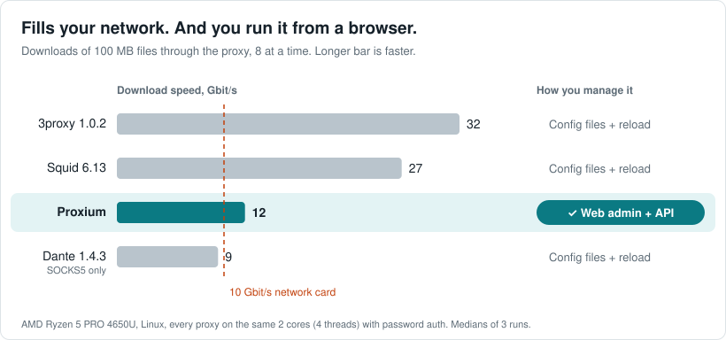
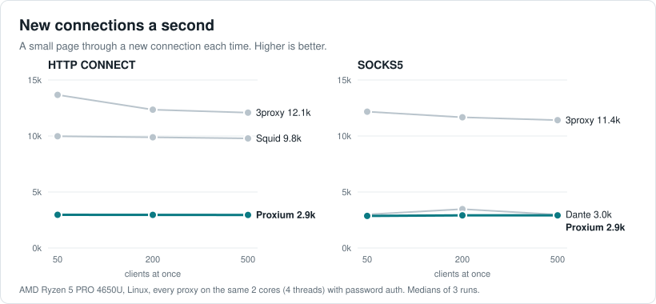
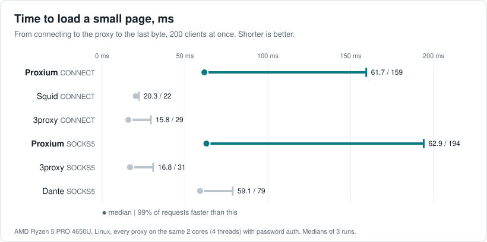
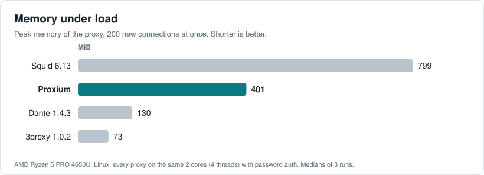

# Benchmark on Linux

The same contenders and scenarios as in [Benchmark](benchmark.md), on a Linux server with a 15 W laptop processor:
every proxy gets 2 cores.

- **Fills a 10 Gbit/s link on 2 laptop cores**: 12 Gbit/s. Dante stays below the link at 9.5.
- **On a par with Dante on SOCKS5**: about 2,900 new connections a second against 3,000–3,500.
- **Half the memory of Squid**: about 400 MiB against 800.
- **Steady under load**: the same 2,950 new tunnels a second from 50 to 500 clients at once, and the same within
  a few percent from run to run.
- **More than enough, and it scales.** One [worker](proxy.md#workers) per core, more servers on one database:
  connection limits, speed limits and quotas hold across all of them, every [instance](proxy.md#instances) shows in
  the admin UI.
- **The only one managed in a browser.** Accounts, policies, outgoing IPs and traffic live in a web admin UI and a
  REST API. The others are configured in files and reloaded.

## Results

Every request opens a new connection to the proxy, so every result includes authentication. No errors in any run.

With 32 downloads at a time instead of 8 the picture holds: Proxium 11.5 Gbit/s over CONNECT and 11.3 over
SOCKS5.

On plain HTTP with 200 clients: Proxium 2.4k, Squid 10.9k, 3proxy 13.0k. Squid keeps connections to the target
open between plain HTTP requests, Proxium opens a new one for each.

Proxium's memory stays flat under load: 409 MiB at 500 clients, 530 MiB with 32 downloads at a time.

## How it was measured

- **Host**: AMD Ryzen 5 PRO 4650U, 6 cores, 12 threads, 15 W, up to 4 GHz. Debian 13 in an LXC container,
  Docker 29.9.
- **Cores**: every proxy pinned to the same 2 cores (4 threads), the load generator to 3 others, the target and
  Proxium's database and Redis to the last one.
- **Runs**: every scenario 3 times, each round starting from a different contender. The charts show medians.

The contenders, the load, the fairness notes and the configs are the same as in [Benchmark](benchmark.md#how-it-was-measured).
