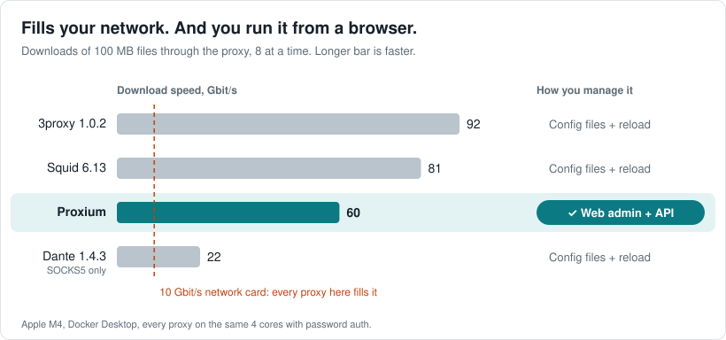
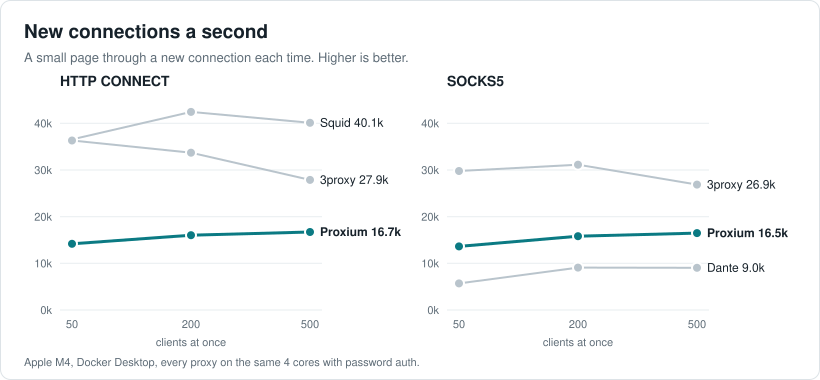
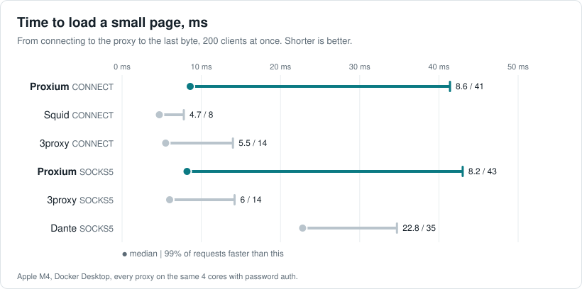
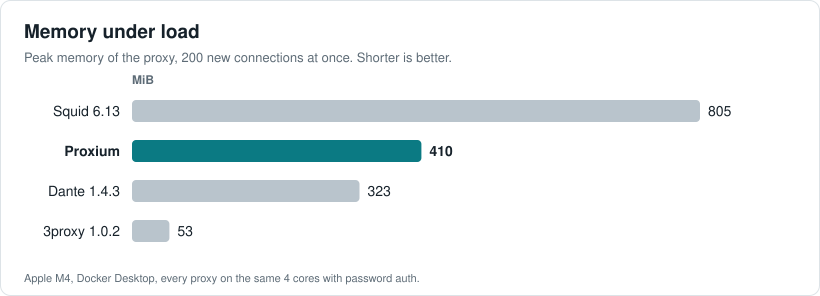

# Benchmark

Proxium against Squid, 3proxy and Dante on the same 4 cores, each set up as a production forward proxy with
password authentication.

- **Downloads hit the network first.** Proxium pushes about 60 Gbit/s through 4 cores, six times what a 10 Gbit/s
  network card carries. On a real server the link runs out long before the proxy does.
- **16,000 new tunnels a second** on 4 cores, over a billion a day, and more as the load grows: 14.2k at 50
  clients at once, 16.7k at 500.
- **Ahead of Dante on SOCKS5**: 1.7 times the connections, 2.4 times the download speed.
- **Half the memory of Squid**: about 410 MiB against 810.
- **More than enough, and it scales.** One [worker](proxy.md#workers) per core, more servers on one database:
  connection limits, speed limits and quotas hold across all of them, every [instance](proxy.md#instances) shows in
  the admin UI.
- **The only one managed in a browser.** Accounts, policies, outgoing IPs and traffic live in a web admin UI and a
  REST API. The others are configured in files and reloaded.

Also measured on a Linux server with a 15 W laptop processor: [Benchmark on Linux](benchmark-linux.md).

## Results

Every request opens a new connection to the proxy, so every result includes authentication. No errors in any run.

With 32 downloads at a time instead of 8 the picture holds: Proxium 63 Gbit/s over CONNECT and 54 over SOCKS5.

Proxium gains as clients pile up, 3proxy loses a quarter. On plain HTTP with 200 clients: Proxium 12.9k, 3proxy
31.2k, Squid 51.7k. Squid keeps connections to the target open between plain HTTP requests, Proxium opens a new one
for each.

A target on the internet answers in 20–200 ms, the proxy adds a few of them.

Proxium's memory stays flat under load: 416 MiB at 500 clients, 440 MiB with 32 downloads at a time.

## How it was measured

- **Host**: Apple M4, Docker Desktop 29.9 on macOS. The numbers compare the proxies with each other; a Linux server
  with dedicated cores gives other absolute values.
- **Cores**: every proxy pinned to the same 4 cores, the load generator to 5 others, the target and Proxium's
  database and Redis to one more.
- **Contenders**: Squid 6.13 (Canonical's image), 3proxy 1.0.2 (the official image), Dante 1.4.3 (as packaged in
  Ubuntu 24.04, no official image). Proxium with 4 workers.
- **Target**: nginx 1.27 serving a small page and a 100 MB file.
- **Load**: a generator in Go. A new connection to the proxy for every request, `Connection: close`, 5 seconds of
  warmup, then 10 seconds for small pages and 20 seconds for downloads.
- **CPU and memory**: read from the containers' cgroups.

Fairness:

- Every proxy checks a username and password, logging is off or at errors only, Squid's cache is off.
- Squid runs with 4 SMP workers. Its image starts it with `-N`, which ignores `workers`, so it runs with
  `--foreground` instead.
- Squid caches checked credentials for 10 seconds, like Proxium caches accounts.
- Dante checks the system password on every connection with no cache. The user's password is hashed with
  MD5-crypt, like Squid's: with Ubuntu's default yescrypt Dante tops out at about 150 connections a second.

The configs of the contenders: [Squid](benchmark/squid.conf) with its [password file](benchmark/passwd),
[3proxy](benchmark/3proxy.cfg), [Dante](benchmark/danted.conf), the target [nginx](benchmark/nginx.conf). The test
user is `bench` with the password `bench`.
